# Banco digital com Java e orientação a objetos

[](https://github.com/barbozadevti/java-banco-digital-poo/actions/workflows/ci.yml)

Entrega do desafio de projeto **"Criando um Banco Digital com Java e Orientação a Objetos"**, da [DIO](https://www.dio.me). A base reproduz o [projeto de referência](https://github.com/falvojr/dio-live-20210802) (`IConta`, `Conta`, `ContaCorrente`, `ContaPoupanca`, `Cliente`, `Banco`), com as melhorias descritas abaixo.

> Versão completa para portfólio: **[barbozadevti/cofre](https://github.com/barbozadevti/cofre)**, um banco digital com Spring Boot, login por perfil, Pix com QR Code, cheque especial e poupança com rendimento.



O diagrama está em Mermaid: [`diagrama/banco.mmd`](diagrama/banco.mmd).

## Os quatro pilares no código

| Pilar | Onde aparece |
|---|---|
| **Abstração** | `IConta` diz o que toda conta faz (sacar, depositar, transferir, imprimir extrato), sem dizer como. `Conta` é abstrata: não existe "conta genérica" no banco. |
| **Encapsulamento** | O saldo é `private` e só muda por `debitar` e `creditar`, que validam o valor e registram a transação. Não há `setSaldo`. O CPF aparece mascarado no extrato. |
| **Herança** | `ContaCorrente` e `ContaPoupanca` herdam numeração, saldo, extrato e transferência de `Conta`. |
| **Polimorfismo** | `disponivelParaSaque()` é sobrescrito: na corrente, soma o cheque especial; na poupança, é só o saldo. O mesmo `sacar` se comporta diferente em cada conta. O extrato usa o padrão *template method*: o cabeçalho e os detalhes mudam conforme o tipo. |

## O que foi além da referência

- **`BigDecimal` para dinheiro**, com arredondamento bancário (`HALF_EVEN`). Com `double`, 0,10 + 0,20 dá 0,30000000000000004.
- **Extrato de verdade:** cada operação vira uma `Transacao` (um `record` imutável) com data, tipo, valor e saldo depois da operação.
- **Regras de negócio com exceções:** valor zero ou negativo é recusado, e `SaldoInsuficienteException` explica o disponível e o pedido.
- **Transferência atômica:** o destino só recebe se o débito na origem deu certo. Também não é possível transferir para a própria conta.
- **Cheque especial** na conta corrente (limite padrão de R$ 500,00) e **tarifa mensal**.
- **Rendimento** da poupança (0,5% ao mês, com juros sobre juros).
- **Cliente com CPF validado** pelos dígitos verificadores.
- **Banco:** busca de conta, contas de um cliente, lista de clientes sem repetir e total em depósitos.

## Como rodar

Requer o JDK 21.

```bash
javac -encoding UTF-8 -d out src/*.java
java -cp out Main
```

```text
=== Extrato Conta Corrente ===
Titular: Rafael Barboza (CPF ***.***.247-25)
Agência: 1  Conta: 1
30/09 21:35  Depósito                        R$ 1.000,00
30/09 21:35  Para Rafael Barboza              -R$ 300,00
30/09 21:35  Saque                            -R$ 850,00
Saldo: -R$ 150,00
Limite do cheque especial: R$ 500,00 (em uso)
Disponível para saque: R$ 350,00

=== Extrato Conta Poupança ===
Titular: Rafael Barboza (CPF ***.***.247-25)
Agência: 1  Conta: 2
30/09 21:35  De Rafael Barboza                 R$ 300,00
30/09 21:35  Rendimento                          R$ 1,50
30/09 21:35  Para Ana Souza                   -R$ 100,00
Saldo: R$ 201,50
Rendimento acumulado: R$ 1,50
...
Operação recusada: Saldo insuficiente: disponível R$ 201,50, pedido R$ 5.000,00.
Clientes do Banco Digital: [Ana Souza, Rafael Barboza]
Total em depósitos: R$ 151,50
```

## Testes

```bash
bash tests/testar.sh
```

17 testes em Java puro, sem dependências: centavos com `BigDecimal`, valores inválidos, saldo insuficiente, limite do cheque especial, transferência que não credita quando o débito falha, rendimento com arredondamento bancário, tarifa, CPF, extrato de cada tipo de conta e as consultas do banco. Rodam também no GitHub Actions a cada envio.
